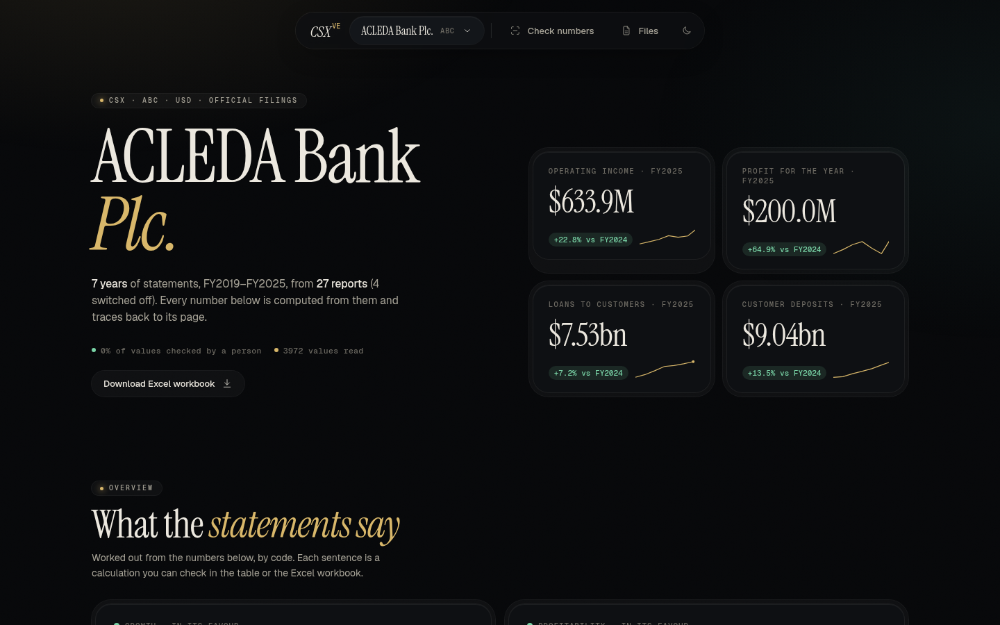
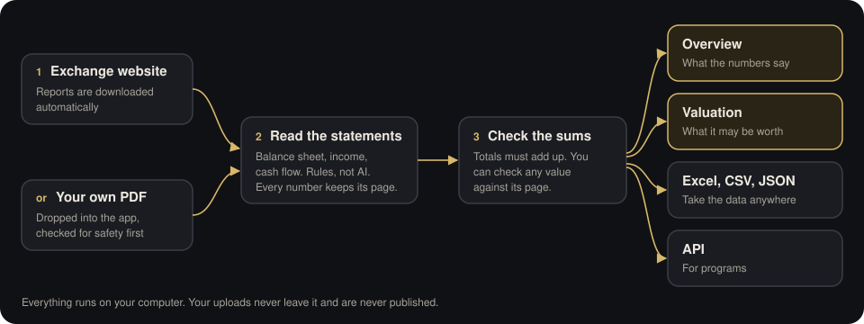

# CSX Valuation Engine

Turns the reports of companies listed on the Cambodia Securities Exchange (CSX) into clean, checked
numbers, then explains what those numbers say and what each company may be worth.

## What it does

- **Gets the reports for you.** Downloads every company's annual report from the exchange and reads the
  three financial statements out of them. You don't have to type in any numbers.
- **Checks them.** Totals must add up, and every number links back to the page it came from.
- **Explains them.** A plain-language overview: is the company growing, is it profitable, does the profit
  come in as cash, how much does it owe, and does it earn more than investors require.
- **Values the company** with a method that fits its industry. You get a range, every step of the maths,
  and where each input comes from.
- **Lets you take the data away** as an Excel workbook, a CSV or JSON file, or a small API.
- **Reads your own reports too**, for companies that aren't listed ([how](#add-your-own-reports)). Your
  files stay on your computer.

## Start (no coding needed)

**1. Download it.** At the top of this page, click the green **Code** button, then **Download ZIP**. Unzip
the file (double-click it on a Mac; on Windows, right-click it and choose **Extract All**).

**2. Install Python** (free, once). Get it from [python.org/downloads](https://www.python.org/downloads/)
and install it like any app. On Windows, tick **"Add python.exe to PATH"** on the first screen of the
installer.

**3. Open the app.** In the unzipped folder:

| Windows | Mac | Linux |
|---|---|---|
| double-click **`csx.bat`** | right-click **`start.command`**, choose **Open**, then **Open** again | open a terminal in the folder and type **`./csx`** |

A black window opens and your browser shows the app. Keep the black window open while you use it, and
close it when you're done. The first time takes about a minute to set up; after that it opens at once.
It fetches the reports from the exchange by itself, and companies appear as they're read.

Windows may say "Windows protected your PC": click **More info**, then **Run anyway**. The Mac asks
about opening the file only the first time.

Something not working? See [If something goes wrong](docs/TUTORIAL.md#if-something-goes-wrong).

## Add your own reports

You aren't limited to the companies on the exchange. Click **Files** in the app, choose the kind of report
(annual, half-year, quarterly), give the company a short code and a name, and drop the PDF. The app runs
three checks and shows what it found before anything is used:

1. **Safe file:** a real PDF, not encrypted, with no scripts or attached files.
2. **Statements found:** balance sheet, income statement and cash flow statement.
3. **Sums add up:** totals match their rows, and the balance sheet balances.

Your report then gets the same overview, valuation (pick its sector) and exports as a listed company. It
stays on your computer: uploads are never published or sent anywhere. Add one file at a time, so you see
each result before the next. If a statement was missed, **Edit pages** lets you point it at the right
pages.

**What reads well:** text PDFs in English (not scans) with the three statements laid out the usual way for
company accounts (IFRS style, as Cambodian companies and most of Asia and Europe print them), with amounts
in US dollars or riel. **Not yet:** US 10-K filings and amounts in other currencies, scanned pages, and
Khmer-language reports. A file it can't read is refused with the reason; it never guesses numbers.

## Commands (optional)

You don't need these to use the app. For people who like the terminal, from this folder: `./csx ...` on Mac and Linux, `csx ...` on Windows (`.\csx ...` in PowerShell).

| Command | What it does |
|---|---|
| `csx` | open the app (sets up and updates by itself) |
| `csx update` | get new reports and prices now |
| `csx value ABC` | ABC's valuation, step by step |
| `csx export ABC` | ABC's Excel workbook (`csx export ABC csv` for a CSV file) |
| `csx api` | the data as a JSON API on this computer |
| `csx test` | run the tests |
| `csx help` | all commands |

All the commands, including the rarely used ones, are in [docs/COMMANDS.md](docs/COMMANDS.md).

## How it works

**New here?** The [tutorial](docs/TUTORIAL.md) walks through every screen with pictures.

## Good to know

- **Internet:** the first update downloads about 700 MB of annual reports. Add quarterly reports with
  `csx update --all` (about 2.5 GB). It needs a network that can reach csx.com.kh. When the site doesn't
  answer, the app keeps working with the data it already has.
- **What it can read:** see [Add your own reports](#add-your-own-reports). No layout is guaranteed: a report
  it can't read is listed as not read, and you never get made-up numbers.
- **Everything runs on your computer.** Your uploads are never published.
- **Not investment advice.** The valuations are estimates for learning, built from public reports and
  assumptions you can change.

## More

- [Tutorial](docs/TUTORIAL.md): using the app, step by step
- [Commands](docs/COMMANDS.md): every command
- [Developing](docs/DEVELOPING.md): how the code works, what the reader can read, how it stays fast

Licence: PolyForm Noncommercial 1.0.0 with extra permission for students, teaching, research and
competitions (see `NOTICE.md`). Data comes from documents published by the companies and the exchange,
which remain theirs.
