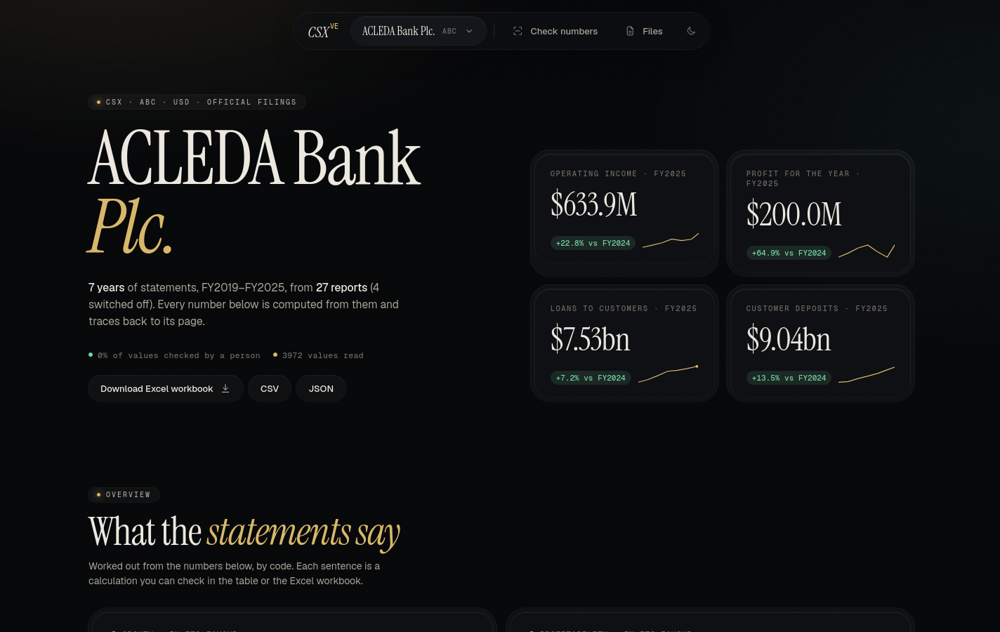
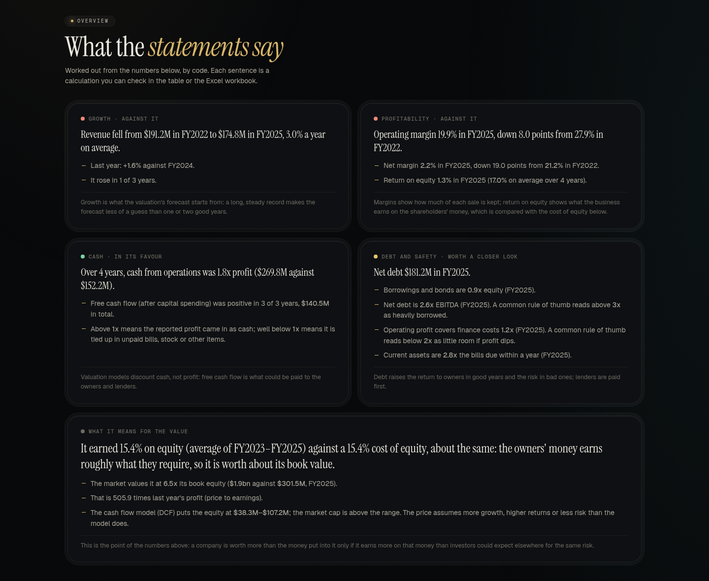
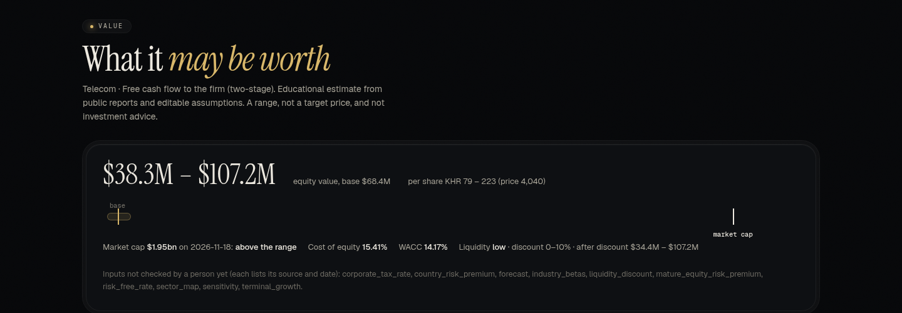
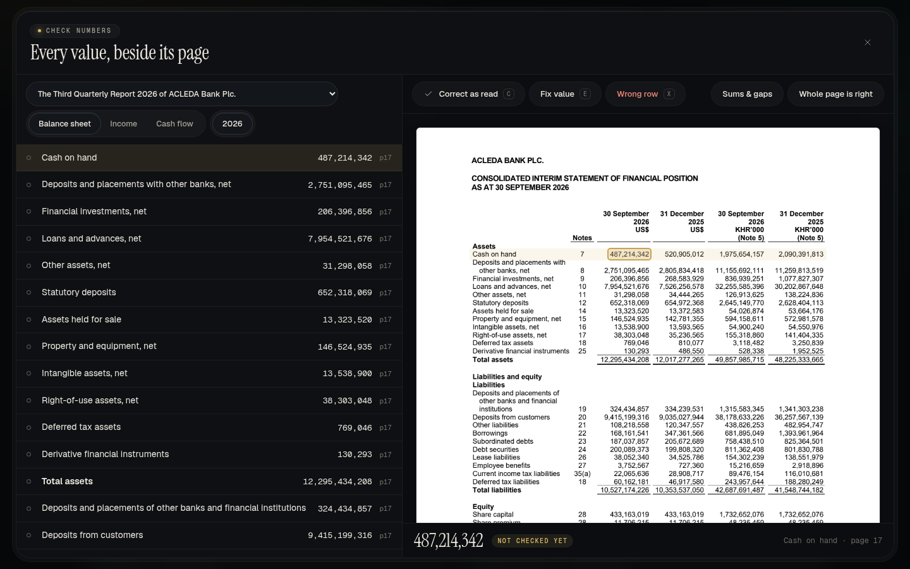
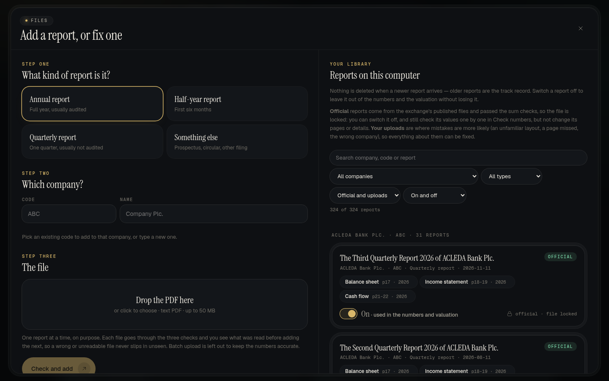

# Tutorial: using the app

About ten minutes. You don't need to know finance: every word is explained at the bottom.

## 1. Start it

If you haven't yet, follow the three steps under **Start** in the [README](../README.md): download, install
Python, open. Then, each time you want to use it, double-click **`csx.bat`** (Windows) or
**`start.command`** (Mac), or run **`./csx`** (Linux). Your browser opens the app.

The first time, a small bar at the bottom says it is getting reports from the exchange. Leave it running;
companies appear one by one as they are read. Later starts are instant.

To stop the app, close the black terminal window (or press Ctrl+C in it).

## 2. Pick a company

Click the company name at the top. A list opens with a search box: type part of a name or code (for
example `bank` or `ABC`) and press Enter, or scroll and click.

At the top you see how many years of reports it has and four key figures with their trend. For most
companies these are revenue, profit, free cash flow and net debt. For a bank they are operating income,
profit, loans and deposits, because banks report differently.

**Download Excel workbook** gives you every number, the ratios as live formulas, prices and sources.
**CSV** and **JSON** give the same statements as one plain table, with the same columns for every
company: handy for your own spreadsheet analysis or a program.

## 3. Read the overview

Scroll down to **What the statements say**. This is the short answer to "so what do all these numbers
mean?". Each card answers one question, using numbers from the reports:

- **Growth:** is it selling more each year?
- **Profitability:** how much of each sale does it keep?
- **Cash:** does the profit actually arrive as cash?
- **Debt and safety:** how much does it owe, and can it pay the interest?
- **What it means for the value:** the most important card. A company is worth more than the money put into
  it only if it earns more on that money than investors want for the risk. This card compares the two, and
  then compares the market price with the valuation.

The coloured dot says whether the numbers are in the company's favour (green), against it (red), or worth a
closer look (yellow). Each card ends with a line on why that topic matters.

## 4. See what it may be worth

Further down, **What it may be worth** shows a valuation range, a bar with the share price, and every step.

- The range runs from a careful case to a hopeful one. It is not a target price.
- "Market cap above / within / below the range" compares what the market pays with the estimate.
- Open **How it is worked out** to see each step, and **Inputs** to see where every assumption comes from.
- Some companies show "No meaningful value" or "Not enough history". Those are honest answers, not errors.

## 5. Check a number against its page

Click **Check numbers** at the top. Pick a report and a statement, then click any row: the page from the
report appears beside it with the number highlighted.

- **Correct as read** (key C): the number matches the page.
- **Fix value** (key E): type the right number. The report and valuation use it right away.
- **Wrong row** (key X): the row shouldn't be there.

You can undo any of these.

## 6. Add your own report

Click **Files**. Choose the kind of report, type a short code and the company name, and drop the PDF.

The app runs three checks (safe file, statements found, totals add up) and shows the result. Add one file
at a time, so you see each result before the next. Your uploads stay on your computer and are never
published.

If a statement was missed or read from the wrong page, use **Edit pages** on that report: type the right
pages (for example `10-11`) and save.

Reports from the exchange are marked **official** and their files are locked. You can still switch them
off or check their numbers.

## 7. Keep it up to date

Nothing to do: it checks for new reports once a week when you start it. To check now, run `csx update`.
For quarterly reports too, run `csx update --all`.

---

## If something goes wrong

| What you see | What to do |
|---|---|
| "Python is not installed" or "Python 3.11 or newer is needed" | Install Python from [python.org/downloads](https://www.python.org/downloads/) (on Windows, tick "Add python.exe to PATH"), then try again. |
| The black window opens and closes at once | Open it again: the message now stays on screen. It usually means Python is missing. |
| Mac: "cannot be opened because it is from an unidentified developer" | Right-click `start.command`, choose **Open**, then **Open** again. |
| Windows: "Windows protected your PC" | Click **More info**, then **Run anyway**. |
| The browser doesn't open | Open your browser and go to `http://127.0.0.1:8770`. |
| "The exchange's website did not answer" | The internet connection can't reach csx.com.kh right now (some networks block it). The app works with what it already has and tries again next time. |
| "the app is already running" | It is already open in another black window; the browser shows that one. |
| No companies yet | The first download takes a while. Watch the bar at the bottom; companies appear one by one. |

## Words used in the app

| Word | Meaning |
|---|---|
| Revenue | Money from sales before any costs. |
| Operating income (banks) | A bank's revenue: interest earned minus interest paid, plus fees. |
| Margin | The share of revenue kept as profit (operating margin: before interest and tax). |
| Free cash flow | Cash from the business minus spending on equipment and buildings. What could be paid out. |
| Net debt | Borrowings minus cash. Negative means more cash than debt. |
| Interest cover | How many times operating profit covers the interest bill. |
| Return on equity (ROE) | Profit as a share of the owners' money in the company. |
| Cost of equity | The return investors want for the risk of owning the shares. |
| Book value | What the company's own accounts say the owners' share is worth. |
| Price to book (P/B) | Market value divided by book value. |
| Price to earnings (P/E) | Market value divided by a year's profit. |
| Cost to income (banks) | The share of a bank's income spent on running it. |
| Cost of risk (banks) | Loan losses as a share of loans. |
| Market cap | Share price times the number of shares: what the market pays for the whole company. |
